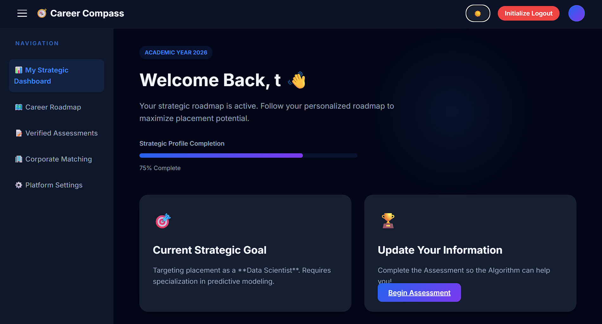
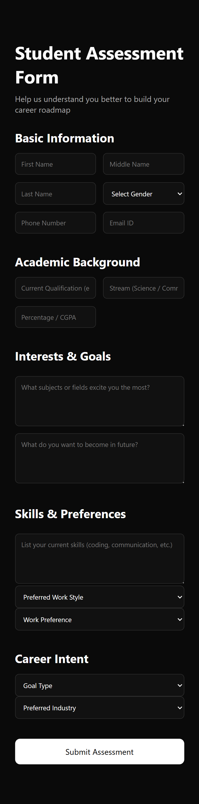
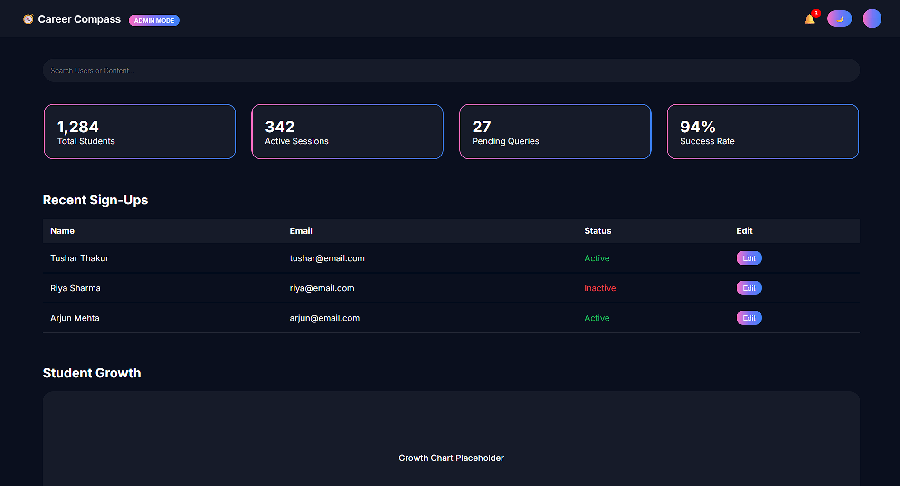
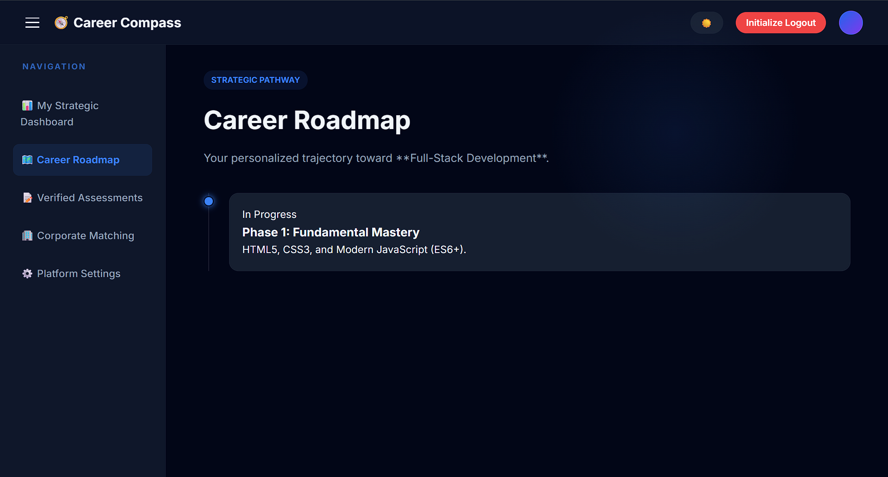
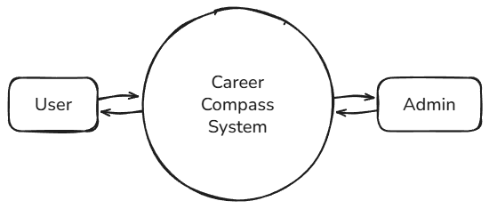

# 🧭 Career Compass

> **An AI-powered career guidance and student assessment web application built with HTML, CSS, JavaScript, Make.com automation, Google Gemini, and Google Sheets.**

**Career Compass** is a career-exploration project that brings together student registration, an assessment questionnaire, AI-assisted career guidance, and dashboard experiences. Its browser-based frontend communicates with **Make.com workflows**, which coordinate data operations and external services including **Google Sheets**, **Google Gemini**, and automated emails.

> **Project scope:** An academic/portfolio prototype. The repository includes frontend pages, Make.com workflow exports, and extensive project documentation. Live integrations require your own configured services. Security and end-to-end behavior should be reviewed before public deployment.

---

## ✨ Highlights

- 🌐 Landing page with interactive sections and navigation
- 👤 Registration and login forms linked to automation workflows
- 🎓 Dedicated student dashboard
- 🛡️ Dedicated admin dashboard prototype
- 📝 Student career assessment form
- 🤖 AI-assisted career roadmap generation through Gemini-powered automation
- 🔄 Make.com webhook integrations and workflow exports
- 📊 Google Sheets-based records in the automation design
- 📩 Automated welcome and assessment-report email workflows
- 🎨 Light/dark theme selection
- 📱 Responsive interface elements
- 🧩 Architecture diagrams, screenshots, presentation, and documentation

---

# 📌 Table of Contents

- [About the Project](#-about-the-project)
- [Features](#-features)
- [Tech Stack](#️-tech-stack)
- [Project Structure](#-project-structure)
- [Application Flow](#-application-flow)
- [Data and Integrations](#-data-and-integrations)
- [Requirements](#-requirements)
- [Service Setup](#-service-setup)
- [Configuration](#️-configuration)
- [Running the Application](#️-running-the-application)
- [Major Application Modules](#-major-application-modules)
- [Project Screenshots](#-project-screenshots)
- [Documentation and Diagrams](#-documentation-and-diagrams)
- [Testing Checklist](#-testing-checklist)
- [Security Notes](#-security-notes)
- [Current Limitations](#-current-limitations)
- [Future Improvements](#-future-improvements)
- [GitHub Setup](#-github-setup)
- [Project Status](#-project-status)
- [Development Notes](#-development-notes)
- [Author](#-author)

---

# 📖 About the Project

Career Compass explores how web interfaces, low-code workflow automation, and generative AI can support students as they consider future career directions.

The project is organized around a basic journey:

1. Open the landing page.
2. Register or sign in using the available forms.
3. Access a student-facing dashboard.
4. Fill out an assessment covering academic background, skills, interests, and goals.
5. Send assessment information to a Make.com webhook.
6. Process the information using connected workflow modules, including Gemini AI.
7. Display a generated roadmap in the student experience and deliver a report through the configured email workflow.

The repository also includes an **admin dashboard UI**, diagrams, screenshots, and exported Make.com workflows. Not all administrator features shown on screen are implemented as live operations.

---

# 🚀 Features

## 🌐 Landing Page

- Career Compass introduction and navigation
- Registration and login entry points
- Interactive popups and informational sections
- Theme switching and visual effects

## 👤 Registration and Login

- Browser-based registration and login forms
- Form submission to Make.com webhook endpoints
- Student/admin routing based on frontend logic
- Locally stored display information for the dashboard

> **Important:** The existing frontend role logic is not secure role-based authorization. Do not treat this as production authentication.

## 🎓 Student Dashboard

- Personalized welcome and profile interface
- Sections for career-related content
- AI roadmap display using browser storage
- Navigation, theme selection, and logout controls

## 📝 Career Assessment

- Personal and academic information
- Interests and career goals
- Skills and preferences
- Career intent questions
- Automation-assisted assessment submission

## 🤖 AI Career Guidance

- Workflow-based processing of student responses
- Gemini integration through Make.com
- Intended personalized roadmap and assessment output
- Roadmap content displayed on the student dashboard when available

> AI outputs are advisory, not guaranteed predictions or substitutes for academic/career counseling.

## 🛡️ Admin Dashboard

- Separate admin-themed interface
- Dashboard cards and status sections
- Navigation and theme controls
- Placeholder/under-construction management areas

> Some dashboard figures and panels are illustrative UI content rather than verified live metrics.

## 📩 Automated Communication

The supplied backend workflows and assets document automation for:

- Welcome messages
- Assessment/report email delivery
- Webhook-triggered processing

Actual delivery depends on valid connected accounts and working Make.com scenarios.

---

# 🛠️ Tech Stack

| Layer | Technology |
|---|---|
| Frontend structure | HTML5 |
| Styling | CSS3 |
| Client-side logic | Vanilla JavaScript |
| API communication | Fetch API / HTTP webhooks |
| Workflow orchestration | Make.com |
| AI processing | Google Gemini (via workflow integration) |
| Data storage | Google Sheets (via workflow integration) |
| Automated email | Make.com email integrations |
| Browser persistence | `localStorage` |
| Version control | Git |
| Repository hosting | GitHub |
| Development tools | VS Code / modern web browser |

**Architecture note:** This version does **not** contain a conventional Node.js, Java Spring Boot, or Python server in the uploaded source. The backend logic is represented mainly by exported Make.com scenarios.

---

# 📁 Project Structure

```text
Career Compass/
│
├── README.md
│
├── Frontend/
│   ├── MainWeb.html
│   ├── MainWeb.css
│   ├── MainWeb.js
│   ├── Student.html
│   ├── Student.css
│   ├── Student.js
│   ├── Admin.html
│   ├── Admin.css
│   ├── Admin.js
│   ├── Assessment.html
│   ├── Assessment.css
│   └── Assessment.js
│
├── Backend/
│   ├── User Workflow.json
│   ├── Assessment Workflow.json
│   └── [saved webpage/export artifacts]*
│
└── Assets/
    ├── Diagrams/
    │   ├── Component_diagram.png
    │   ├── Deployment_architecture.png
    │   ├── ER_diagram.png
    │   ├── Level_0DFD.png
    │   ├── Level_1DFD.png
    │   ├── Level_2DFD.png
    │   ├── Sys_architechture.png
    │   ├── Sys_flowchart.png
    │   └── Testing_Workflow.png
    ├── Screenshots/
    │   ├── Frontend/
    │   └── Backend/
    ├── Text Files/
    ├── Career Compass Documentation.pdf
    ├── Career Compass Presentation.pptx
    ├── Automated Welcoming Email.pdf
    ├── Automated Report Email.pdf
    └── Career_Compass-demo.mp4
```

\*The original archive includes a saved workflow webpage and related downloaded dependencies. These are not needed to import the two JSON workflow blueprints and may be omitted when cleaning the GitHub repository.

> The demo video is relatively large. You may prefer to host it separately and link to it rather than commit the file.

---

# 🔄 Application Flow

```text
Visitor
   │
   ▼
Main Website (MainWeb.html)
   │
   ├── Register / Login ──► Make.com User Workflow
   │                              │
   │                              ├──► Google Sheets
   │                              └──► Email integration
   │
   ├── Student Dashboard
   │         │
   │         ▼
   │    Assessment Form
   │         │
   │         ▼
   │    Make.com Assessment Workflow
   │         │
   │         ├──► Google Sheets
   │         ├──► Gemini AI
   │         └──► Automated report email
   │         │
   │         ▼
   │    Roadmap / Assessment Output
   │
   └── Admin Dashboard (prototype UI)
```

### Assessment data flow

```text
Student inputs
     │
     ▼
Assessment.js
     │
     ▼
HTTP webhook request
     │
     ▼
Make.com workflow
     │
     ├── Data storage / retrieval
     ├── AI processing
     └── Email automation
     │
     ▼
Frontend receives output (when returned)
     │
     ▼
Roadmap saved/displayed in browser
```

---

# 🗄️ Data and Integrations

| Component | Responsibility |
|---|---|
| Registration/login frontend | Captures and submits user-entered details |
| User Workflow | Orchestrates webhook-driven user actions |
| Assessment frontend | Collects educational background and career preferences |
| Assessment Workflow | Orchestrates assessment and AI/report steps |
| Google Sheets | External data storage used by workflow modules |
| Gemini AI | Produces AI-assisted guidance in the automation design |
| Email service | Sends welcome/report messages when configured |
| Browser `localStorage` | Stores display preferences and some user/roadmap content |

The actual spreadsheet schema and connected service permissions are configured outside the HTML/CSS/JavaScript source, so the workflow must be reviewed and reconnected in each environment.

---

# ✅ Requirements

- A modern browser (Chrome, Edge, or Firefox)
- A code editor such as VS Code
- Optional local static server (for example, VS Code Live Server)
- A Make.com account for automation-backed functionality
- A Google account and an appropriately configured Google Sheet
- Gemini API access or the Google AI service connection supported by your Make.com scenario
- Email service connection for automated messages
- Git and a GitHub account for repository publishing

**No package installation or build step is required for the included static frontend.**

---

# 🔌 Service Setup

## 1. Make.com Workflows

1. Open your Make.com account.
2. Create scenarios by importing `Backend/User Workflow.json` and `Backend/Assessment Workflow.json` as blueprints, where supported.
3. Review every imported module before enabling the scenarios.
4. Reconnect the required Google Sheets, Gemini, and email services.
5. Replace the blueprint's webhook references with newly created webhooks.
6. Check the expected request and response fields against the frontend JavaScript.
7. Test each scenario with non-sensitive sample input.

## 2. Google Sheets

Create or connect the sheets required by the imported scenarios and verify their expected columns and permissions. Do not assume imported spreadsheet identifiers will work in another account.

## 3. Gemini and Email

Connect the AI and email services inside Make.com. Keep any API keys or account credentials in the provider's secret/connection controls, **not** in committed frontend files.

---

# ⚙️ Configuration

The existing frontend source references webhook endpoints in:

```text
Frontend/MainWeb.js
Frontend/Assessment.js
```

Before publishing or reusing the project:

- Rotate any previously exposed Make.com webhook URLs.
- Review workflow exports for identifying data, tokens, and account details.
- Update the frontend endpoint references to your own configuration.
- Treat browser-visible endpoint values as **public**, even when stored in a separate `.js` file.
- Protect sensitive actions with server-side validation, rate limiting, and access controls.

A production system should route sensitive operations through a secured backend rather than relying on secret values embedded in JavaScript delivered to the browser.

---

# ▶️ Running the Application

## Option 1 — Open in a Browser

1. Extract or clone the project.
2. Open the `Frontend` directory.
3. Open `MainWeb.html` in your browser.
4. Explore the interface and navigate through the available pages.

Some integrations may require serving the files from a local HTTP server rather than directly opening them from the filesystem.

## Option 2 — VS Code Live Server

1. Open the project folder in VS Code.
2. Install the **Live Server** extension if needed.
3. Open `Frontend/MainWeb.html`.
4. Choose **Open with Live Server**.
5. Use the URL shown by the extension.

> **Offline/demo mode:** The visual pages can be explored without connected Make.com services, but registration, login, assessment processing, and email automation cannot be assumed to work.

---

# 🧩 Major Application Modules

```text
Career Compass
│
├── Main Website
│   ├── Introduction
│   ├── Registration
│   ├── Login
│   └── Theme / Navigation
│
├── Student Dashboard
│   ├── Welcome / Profile
│   ├── Roadmap Output
│   └── Navigation
│
├── Career Assessment
│   ├── Academic Background
│   ├── Skills & Preferences
│   ├── Interests & Goals
│   └── Submission Workflow
│
├── Admin Dashboard
│   ├── Dashboard UI
│   ├── Status Cards
│   └── Planned Management Features
│
└── Make.com Backend
    ├── User Workflow
    ├── Assessment Workflow
    ├── Google Sheets Integration
    ├── Gemini AI Integration
    └── Email Automation
```

---

# 🖼️ Project Screenshots

### Main Website


### Student Dashboard



### Career Assessment



### Admin Dashboard



### AI Result Interface



> Additional light-theme views, registration/login screens, and backend screenshots are available under `Assets/Screenshots/`.

---

# 🧭 Documentation and Diagrams

| Artifact | File |
|---|---|
| System architecture | [`Sys_architechture.png`](Assets/Diagrams/Sys_architechture.png) |
| System flowchart | [`Sys_flowchart.png`](Assets/Diagrams/Sys_flowchart.png) |
| Component diagram | [`Component_diagram.png`](Assets/Diagrams/Component_diagram.png) |
| Deployment architecture | [`Deployment_architecture.png`](Assets/Diagrams/Deployment_architecture.png) |
| ER diagram | [`ER_diagram.png`](Assets/Diagrams/ER_diagram.png) |
| Data Flow Diagram — Level 0 | [`Level_0DFD.png`](Assets/Diagrams/Level_0DFD.png) |
| Data Flow Diagram — Level 1 | [`Level_1DFD.png`](Assets/Diagrams/Level_1DFD.png) |
| Data Flow Diagram — Level 2 | [`Level_2DFD.png`](Assets/Diagrams/Level_2DFD.png) |
| Testing workflow | [`Testing_Workflow.png`](Assets/Diagrams/Testing_Workflow.png) |
| Full documentation | [`Career Compass Documentation.pdf`](Assets/Career%20Compass%20Documentation.pdf) |
| Presentation | [`Career Compass Presentation.pptx`](Assets/Career%20Compass%20Presentation.pptx) |

### System Architecture Diagram


### Data Flow Diagram



---

# 🧪 Testing Checklist

- [ ] Landing page loads correctly
- [ ] Page navigation works
- [ ] Light/dark theme persists
- [ ] Registration form validates input
- [ ] Registration webhook sends and receives the expected fields
- [ ] Login form handles valid and invalid cases
- [ ] Student dashboard loads the intended user details
- [ ] Admin page displays without UI errors
- [ ] Assessment form accepts expected answers
- [ ] Assessment webhook receives the submitted data
- [ ] Google Sheets actions execute correctly
- [ ] Gemini response is returned/processed correctly
- [ ] Career roadmap is rendered safely
- [ ] Welcome email is sent successfully
- [ ] Assessment report email is sent successfully
- [ ] Browser refresh and logout produce appropriate state changes
- [ ] Responsive views work across mobile and desktop sizes
- [ ] Invalid, duplicate, and malicious inputs are handled safely

**Note:** This is a recommended validation checklist, not a claim that every test has passed.

---

# 🔒 Security Notes

Career Compass is an **academic/portfolio prototype**, not a production-secured platform.

Before publishing or deploying:

- **Rotate exposed webhook URLs** and review permissions on active scenarios.
- Audit exported JSON workflows for credentials, spreadsheet IDs, personal information, and configuration secrets.
- Review screenshots (especially backend automation screenshots) for API keys or other sensitive data before committing them.
- Implement actual server-side authentication and role authorization; frontend role routing is insufficient.
- Validate and sanitize data from users and AI responses before displaying it as HTML.
- Avoid storing sensitive personal data in `localStorage`.
- Restrict access to student records and follow applicable privacy requirements.
- Add request throttling, error handling, audit logs, and security monitoring before production use.

**Do not publish raw API keys, access tokens, personal student records, or secret Make.com connection details in GitHub.**

---

# ⚠️ Current Limitations

- End-to-end AI, spreadsheet, and email functionality depends on external Make.com scenarios and connected accounts.
- Client-side role routing is not a substitute for secure authentication/authorization.
- Some admin dashboard metrics and management sections are placeholders.
- Roadmap presentation uses browser storage and is not a full account-backed history service.
- There is no dedicated application server implementation in this repository.
- Automated tests and deployment configuration are not included as a complete production pipeline.
- AI-generated suggestions should be reviewed for accuracy and relevance.

---

# 🔮 Future Improvements

- Secure backend API and role-based access control
- Proper account sessions and credential management
- Student profile persistence and assessment history
- Admin tools backed by actual data and verified analytics
- Safer structured rendering of AI output
- Reusable assessment scoring and transparent recommendation logic
- Career exploration resources and skill-gap visualization
- Downloadable career roadmap reports
- Progress tracking and milestone notifications
- Automated tests and CI/CD
- Improved accessibility and responsive design
- Database migration from spreadsheets for larger-scale use
- Privacy controls, consent, and account/data deletion options
- Secure public deployment with environment-specific configuration

---

# 🌐 GitHub Setup

Create an empty GitHub repository named `Career-Compass`, then from the project directory run:

```powershell
git init
git branch -M main
git remote add origin https://github.com/tushar-011/Career-Compass.git
```

After reviewing the files for secrets, add an appropriate `.gitignore`, then:

```powershell
git add .
git diff --cached --stat
git commit -m "Initial commit: Career Compass project"
git push -u origin main
```

For later updates:

```powershell
git status
git add .
git commit -m "Update Career Compass documentation and frontend"
git push
```

> Avoid committing the large MP4, imported webpage dependency folders, or files containing secrets. If the GitHub repository already has commits, check its history before using the initial push commands.

---

# 🏁 Project Status

### ✅ Academic prototype and supporting project assets available

The provided repository demonstrates:

- HTML/CSS/JavaScript interface development
- Frontend forms and navigation
- Student and admin dashboard design
- Webhook-based integration
- Make.com workflow automation
- Google Sheets service integration design
- Gemini-powered guidance workflow design
- Email automation design
- Architecture documentation and diagrams
- Screenshot and presentation preparation

**Current stage:** Repository cleanup, security review, end-to-end testing, and GitHub/portfolio publication.

---

# 👨‍💻 Development Notes

Career Compass was developed as an academic project focused on combining **web development, AI-assisted career guidance, and workflow automation**.

It is suitable for:

- Academic demonstration and submission
- Studying integration between frontend and no-code/low-code workflows
- Exploring AI-assisted recommendation experiences
- Understanding external data and email integrations
- Portfolio and GitHub presentation

---

<div align="center">

## 🧭 Career Compass

**Explore • Assess • Discover • Plan**

Built with **HTML + CSS + JavaScript + Make.com + Gemini AI + Google Sheets**

</div>

---

# 👨‍💻 Author

### Tushar Thakur

**MCA Data Science**  
**Chandigarh University**

[](https://github.com/tushar-011)

[](https://www.linkedin.com/in/tushar-thakur-8848a7396/)

[](mailto:artificial.thakur@gmail.com)
